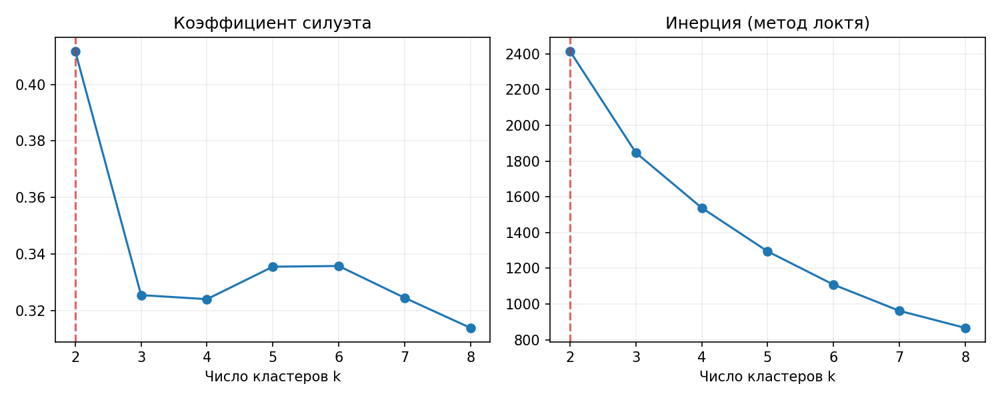
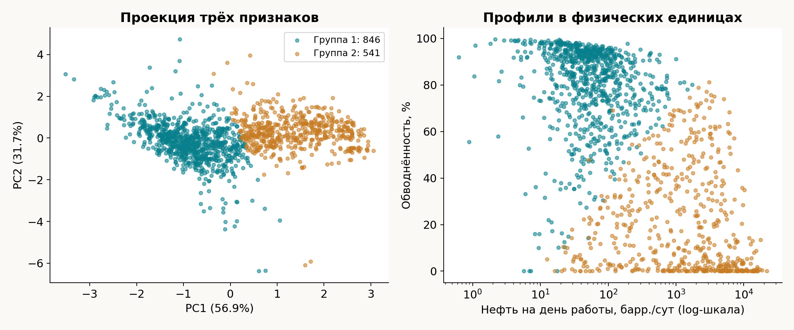
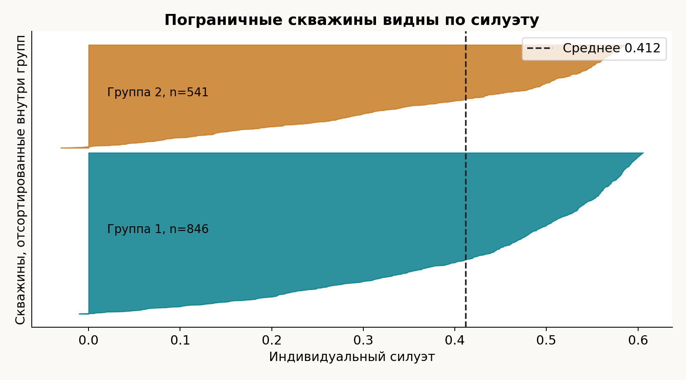

# Кластеризация нефтедобывающих скважин по данным BOEM

Предмет: Анализ данных в нефтегазе 26/27. Тема 9. Основной воспроизводимый кейс.

Источник: [BOEM OGOR-A 2023](https://www.data.boem.gov/main/ogor-a.aspx). Период: январь–декабрь 2023 года. Из 74,986 completion-month записей по 5992 API отобрано 1387 нефтяных стволов. Одна строка модели соответствует 12-значному API, включая код бокового ствола. Это эксплуатационная сегментация выбранного фонда.

## Подготовка и выборка

[Паспорт источника и словарь](../../data/boem/README.md). [Все этапы отбора](../../data/boem/attrition.csv). Данные читаются из зафиксированного ZIP с проверкой SHA256.

| label | before | after |
| --- | --- | --- |
| Все API | 5992 | 5992 |
| Есть добыча нефти | 5992 | 2208 |
| Только нефтяной код O | 2208 | 1797 |
| Нефтедобывающий статус | 1797 | 1797 |
| 12 месяцев отчётности | 1797 | 1756 |
| Один активный completion | 1756 | 1688 |
| Без пересечения дней | 1688 | 1688 |
| Нефть минимум 9 месяцев | 1688 | 1388 |
| Без закачки | 1388 | 1387 |

В выборке остаются API с нефтяным кодом, нефтедобывающими статусами активных записей, отчётностью за 12 месяцев, единственным активным completion и добычей нефти минимум в девяти месяцах. Это исключает двойной счёт дней и ограничивает выводы относительно регулярно работающим фондом. Новые, простаивающие и смешанные нефтегазовые объекты представлены неполно.

## Признаки и модель

Дебит нефти = годовая нефть / дни работы. Обводнённость = 100 × годовая вода / (нефть + вода). Газовый фактор = 1000 × газ в Mcf / нефть в баррелях. Используются отношения сумм; среднее месячных отношений отвечало бы другому вопросу. Пропусков в итоговых признаках нет.

Для дебита и газового фактора применён log1p, затем все три признака стандартизованы. Так уменьшается влияние правых хвостов и различий единиц. Это выбор геометрии расстояния, его чувствительность проверена отдельно. Параметры K-means: n_init=20, random_state=42. Число групп выбирается по максимальному среднему силуэту среди k=2…8. Номера групп упорядочены по среднему дебиту; они не означают качество скважины.

Выбрано k=2, силуэт 0.412. Доля объектов с отрицательным силуэтом 0.7%. В отсутствие эталонных классов это характеристика геометрии, а не точность и не доказательство природных типов.

| k | silhouette | inertia |
| --- | --- | --- |
| 2 | 0.412 | 2415.159 |
| 3 | 0.325 | 1847.159 |
| 4 | 0.324 | 1538.407 |
| 5 | 0.335 | 1294.789 |
| 6 | 0.336 | 1108.865 |
| 7 | 0.324 | 962.290 |
| 8 | 0.314 | 866.724 |



## Профили и конкретные скважины

В таблице ниже медианы индивидуальных годовых характеристик скважин в физических единицах. Медианы удобны при скошенных распределениях и не являются центрами K-means. Файл cluster_profiles.csv отдельно содержит средние тех же характеристик.

| cluster | n_wells | oil_rate_bpd | water_cut_pct | gor_scf_bbl |
| --- | --- | --- | --- | --- |
| 1 | 846 | 51.869 | 85.036 | 1121.302 |
| 2 | 541 | 1592.129 | 12.617 | 872.207 |

Единицы: oil_rate_bpd = барр./сут работы; water_cut_pct = %; gor_scf_bbl = станд. куб. фут/барр.



PCA показывает 88.6% дисперсии. Кластеризация выполнена по трём подготовленным признакам, проекция нужна только для изображения.

Примеры выбраны как ближайшие к центрам групп в пространстве модели:

| well_id | cluster | oil_rate_bpd | water_cut_pct | gor_scf_bbl |
| --- | --- | --- | --- | --- |
| 608174094300 | 1 | 47.593 | 77.156 | 1198.748 |
| 608184004403 | 2 | 1044.992 | 25.692 | 760.013 |

Группа с большей обводнённостью помогает выбрать фонд для сравнения динамики воды и нагрузки на систему подготовки продукции. Для скважин с высоким газовым фактором полезны история давления, режимы сепарации и проверка учёта газа. По инструкции ONRR газлифтный газ уже вычитается из отчётной добычи. Более продуктивные скважины можно сравнивать с аналогами по сохранению добычи. Все эти направления являются задачами дополнительной проверки, а не назначением ремонта.

## Устойчивость и ограничения

ARI при смене seed: 1.000…1.000. Для Ward при том же k: ARI 0.574, силуэт 0.361. В десяти подвыборках по 80% объектов медиана ARI 0.986, диапазон 0.968…0.996. Scaler и модель для подвыборок переобучаются; ARI сравнивается только на общих объектах.

| name | ari | note |
| --- | --- | --- |
| RobustScaler | 0.211 | Те же признаки и log1p; масштабирование по медиане и IQR, k фиксировано. |
| Без log1p | 0.684 | Те же признаки; StandardScaler, k фиксировано. |
| Без газового фактора | 0.943 | Дебит и обводнённость, log1p дебита; k фиксировано. |
| Первое и второе полугодия | 0.839 | 1387 общих API с добычей нефти ≥3 месяцев в каждом полугодии; scaler и K-means обучены отдельно, k фиксировано. |

При замене StandardScaler на RobustScaler совпадение разбиений заметно снижается. Поэтому устойчивость к seed и подвыборкам не означает независимость результата от подготовки признаков. Полученные группы полезны для выбранной схемы сравнения фонда, но не являются универсальными типами скважин.



- Отбор ограничен нефтяными стволами с регулярной добычей в 2023 году; выводы не распространяются на весь фонд BOEM.
- API включает боковой ствол. Скважины одного месторождения связаны общими условиями; 1387 объектов нельзя автоматически считать независимой случайной выборкой.
- Дебит и газовый фактор имеют общий нефтяной объём в формулах. Корреляции и масштабирование влияют на геометрию групп.
- Годовые показатели скрывают динамику. Сравнение полугодий совмещает реальное изменение режима и чувствительность модели.
- В данных нет пластового давления, проницаемости, затрат и причин изменения режима. Кластеры не доказывают геологическую причинность или выгоду ремонта.
- Максимум силуэта среди k≥2 не является проверкой существования естественных кластеров. ARI не является точностью без эталонной разметки.

## Воспроизведение

```bash
python run_analysis.py
```

Версии пакетов, хеши данных и исходников: [run_manifest.json](run_manifest.json). Теория, источники и итоговая интерпретация: [реферат](../../docs/report.md).
