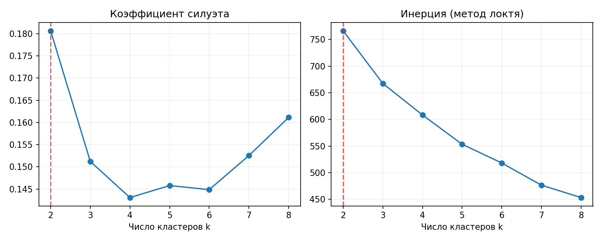
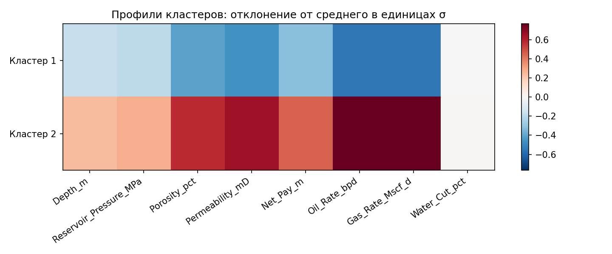
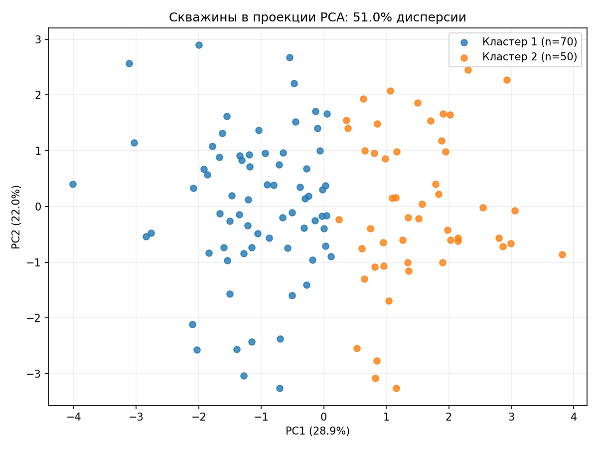

# Кластеризация скважин методом K-means

Источник: **Oil_Gas.csv**.

Обработано 15000 наблюдений по 120 скважинам. Выбрано **k = 2**, коэффициент силуэта **0.181**.

## Подготовка и метод

Одна строка модели — одна скважина. Повторные измерения агрегированы медианой за весь предоставленный период. Это характеристика типичного состояния, а не текущего режима. Пропуски игнорируются при агрегации; оставшиеся пустые медианы заменяются медианой по скважинам. Строки без наблюдаемых выбранных признаков и полностью пустые признаки отклоняются.

Признаки: `Depth_m`, `Reservoir_Pressure_MPa`, `Porosity_pct`, `Permeability_mD`, `Net_Pay_m`, `Oil_Rate_bpd`, `Gas_Rate_Mscf_d`, `Water_Cut_pct`.

Проницаемость, если выбрана, преобразована log(1+x). Затем StandardScaler приводит непостоянные признаки к нулевому среднему и единичной дисперсии. K-means работает в этом пространстве, PCA используется только для иллюстрации. Для каждого k выполняется 20 инициализаций, random_state=42; выбирается максимальный средний силуэт среди проверенных k. Проверки наличия кластеров против модели с одной группой этот критерий не даёт.

Идентификаторы, время и Future_* не участвуют в расстояниях. По умолчанию не включены параметры бурения и многочисленные взаимосвязанные показатели насыщенности, чтобы не смешивать слишком много разных процессов и не усиливать дублирующие признаки.

## Качество данных

Период: 2018-01-01 00:00:00+00:00 — 2028-04-07 18:00:00+00:00. Проверьте происхождение данных и корректность дат перед содержательными выводами.

Наблюдений на скважину: от 125 до 125. Скважины имеют одинаковый вес независимо от числа наблюдений.

| Признак | Пропусков в исходных строках | Заполнено медиан скважин |
| --- | --- | --- |
| Depth_m | 0 | 0 |
| Reservoir_Pressure_MPa | 180 | 0 |
| Porosity_pct | 180 | 0 |
| Permeability_mD | 180 | 0 |
| Net_Pay_m | 0 | 0 |
| Oil_Rate_bpd | 180 | 0 |
| Gas_Rate_Mscf_d | 180 | 0 |
| Water_Cut_pct | 0 | 0 |

Исключены будущие показатели: Future_Oil_Rate_bpd, Future_Gas_Rate_Mscf_d, Future_Reservoir_Pressure_MPa.

Исключены постоянные признаки: нет.

## Выбор числа кластеров

| k | silhouette | inertia |
| --- | --- | --- |
| 2 | 0.181 | 766.354 |
| 3 | 0.151 | 667.620 |
| 4 | 0.143 | 608.486 |
| 5 | 0.146 | 553.507 |
| 6 | 0.145 | 518.308 |
| 7 | 0.153 | 476.699 |
| 8 | 0.161 | 453.439 |

## Профили и интерпретация

В таблице — средние **медианных характеристик скважин** в исходных единицах; это не суммарная добыча и не средние по всем исходным строкам. Заполненные медианы включены в эти средние. Номера групп условны и не означают качество.

| cluster | n_wells | Depth_m | Reservoir_Pressure_MPa | Porosity_pct | Permeability_mD | Net_Pay_m | Oil_Rate_bpd | Gas_Rate_Mscf_d | Water_Cut_pct |
| --- | --- | --- | --- | --- | --- | --- | --- | --- | --- |
| 1 | 70 | 3140.402 | 51.529 | 18.766 | 81.948 | 22.021 | 648.796 | 1336.306 | 21.298 |
| 2 | 50 | 3170.605 | 51.850 | 19.318 | 91.398 | 22.608 | 675.327 | 1358.064 | 21.305 |

### Кластер 1: 70 скважин

Выше среднего по скважинам (не менее 0,5 стандартного отклонения): нет выраженных признаков.
Ниже среднего: Дебит нефти, барр./сут; Дебит газа, тыс. станд. куб. футов/сут.

### Кластер 2: 50 скважин

Выше среднего по скважинам (не менее 0,5 стандартного отклонения): Пористость, %; Проницаемость, мД; Дебит нефти, барр./сут; Дебит газа, тыс. станд. куб. футов/сут.
Ниже среднего: нет выраженных признаков.

Сравнения выше относятся к пространству после преобразований; это описательные пороги, а не статистические тесты значимости.

## Надёжность выводов

**Разделение слабое:** силуэт ниже 0,25 (ориентировочный, не универсальный порог). Группы существенно перекрываются. Такое разбиение удобно как описательная сегментация, но не подтверждает существование естественных типов скважин.

Устойчивость к трём другим начальным состояниям (ARI = 1 означает одинаковое разбиение):

| seed | adjusted_rand_index |
| --- | --- |
| 43 | 1.000 |
| 44 | 1.000 |
| 45 | 1.000 |

Эта проверка касается инициализации алгоритма, а не устойчивости к выборке, периоду или набору признаков.

Для глубины медианное стандартное отклонение внутри скважины — 648.3 м, а отклонение медиан между скважинами — 72.4 м. Внутренняя изменчивость больше межскважинной: нужно уточнить смысл Depth_m, проверить идентификаторы и обоснованность объединения всего периода.

K-means чувствителен к выбросам, выбору признаков и их корреляциям. Медианы скрывают временную динамику; перед эксплуатационными решениями повторите анализ на сопоставимом временном окне и проверьте результаты с геологом/технологом. Причины различий и эффективность мероприятий из кластеризации не следуют.
